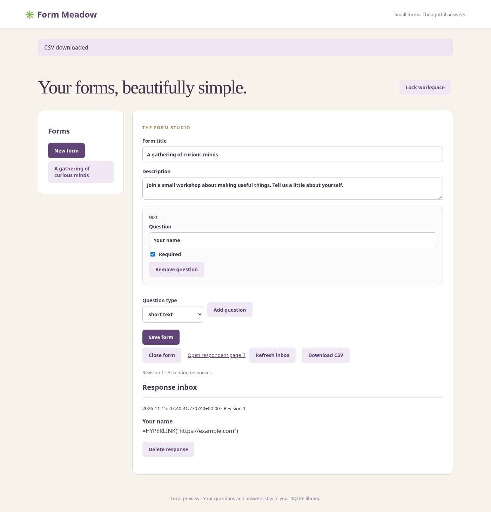

# Form Meadow · local preview



A focused open-source alternative to Tally, in preparation: forms, a response inbox, and CSV export. **The local browser workflow is tested. Production deployment remains unfinished; nothing is published.**

## Run the current component

Python 3.10+; no third-party packages required.

```sh
python3 -m unittest discover -s tests -v
python3 demo.py
```

The disposable demo creates a form, opens it, submits synthetic data, reads the inbox and prints CSV. It never listens on a port or retains personal data. The `Forms` Python API stores real libraries in a SQLite file supplied by its caller.

Implemented: text, email, single-choice and explicit consent fields; required-field validation; closed-by-default forms; immutable question versions; stale-edit/submission detection; idempotent retries; persisted inbox; and CSV export with spreadsheet-formula escaping. CSV uses one row per answer, retaining each response's original label and version. Do not claim legal compliance from the existence of a consent checkbox.

Implemented development API: bearer-authenticated owner routes, unauthenticated open-form reads/submissions, strict loopback Host/Origin checks, 160 KB request limit, 60 respondent attempts per minute, and owner-only response deletion.

The visual builder, respondent page and owner inbox now pass browser acceptance in separate owner/respondent contexts, with CSV download, closed forms and narrow layout. Six interface languages are available: English, German, Spanish, Japanese, Simplified Chinese and Traditional Chinese. Technical diagnostics retain English fallback; native-speaker review remains pending. Production deployment remains unfinished. The storage API has **no authorization layer** and must not be exposed directly over HTTP. No payments, uploads, conditional logic, email delivery, AI, or feature parity with Tally is claimed.

See [scope and distribution](docs/SCOPE.md). MIT licensed. Publication needs the owner's separate product-specific go-ahead.

## Run the development API

```sh
export FORM_MEADOW_OWNER_TOKEN="$(python3 -c 'import secrets; print(secrets.token_urlsafe(32))')"
python3 server.py
```

The server binds only to `127.0.0.1:5143`. Open http://127.0.0.1:5143 in your browser and enter your owner token. Create questions, save the form, then open it to accept responses. The respondent link works on this same machine only; it is not a public share link. Do not expose this development server through a public proxy. Owner requests use `Authorization: Bearer <token>`; never put the token in URLs. JSON writes require `Content-Type: application/json` and a length. Tokens are kept in server memory and are not logged.

| Route | Access | Method |
|---|---|---|
| `/api/owner/forms` | Owner | GET list / POST create |
| `/api/owner/forms/{id}/open` | Owner | POST `{ "open": true }` |
| `/api/owner/forms/{id}/revise` | Owner | POST revision and schema |
| `/api/owner/forms/{id}/inbox` | Owner | GET |
| `/api/owner/forms/{id}/csv` | Owner | GET |
| `/api/owner/forms/{id}/delete-response` | Owner | POST response id |
| `/api/forms/{id}` | Respondent | GET open form only |
| `/api/forms/{id}/submit` | Respondent | POST revision, answers, request_key |

One global respondent attempt budget applies to this single-user development server. It resets on restart; it is not production abuse protection. Deleting a response also deletes its request-key receipt, so a later retry may create a new response if the form remains open. Deletion does not erase backups. Stop the server before copying its SQLite file. No HTTPS, deployment or browser security acceptance is claimed yet.

## Browser verification

Run `npm ci`, `npx playwright install chromium`, then `npm run test:browser`. Set `CHROMIUM_PATH` when using an existing Chromium installation. The runner creates a disposable library and random owner token; screenshots use synthetic data. Owner credentials remain in tab memory, never localStorage or sessionStorage.

Expanded browser acceptance covers required single-choice and consent controls, email validation, inert answer rendering, canceled navigation preserving drafts, stale respondent revisions, original labels in the inbox, and response deletion. Labels use explicit control associations. Language switching preserves drafts and respondent answers. User-authored content is never translated.
